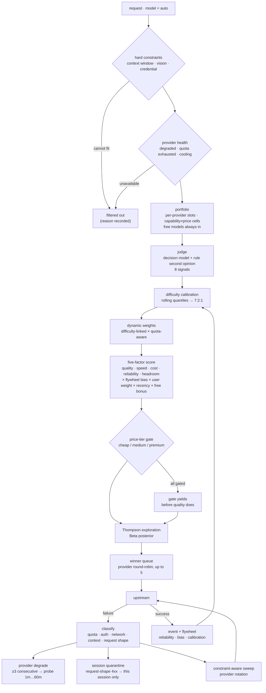
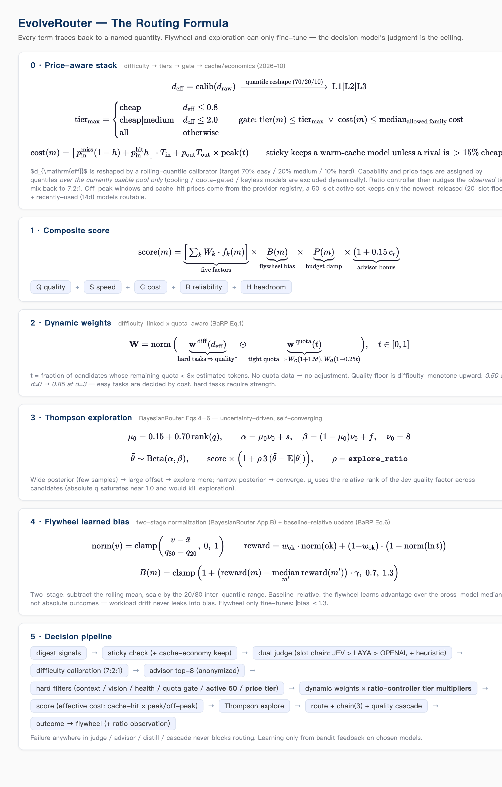

<p align="center">
  
</p>

<h1 align="center">EvolveRouter</h1>

<p align="center"><b>Judged and routed in one pass. Smarter with every request.</b></p>

<p align="center"><a href="README.md">English</a> · <a href="README.zh-CN.md">简体中文</a></p>

<p align="center">
  <a href="LICENSE"></a>
  <a href="#development"></a>
  <a href="https://www.rust-lang.org"></a>
</p>

EvolveRouter is a **local LLM routing gateway** for agents. Every request is judged on eight signals, priced in its own plan's currency, scored on five factors, and routed to the model that fits — then the outcome feeds back so the next decision is better. It ships as one Rust binary with a native macOS menu-bar panel and a zero-build dashboard. Your prompts, sessions and telemetry never leave the machine.

<p align="center">
  
</p>

```
opencode · Claude Code · Codex · Pi · openclaw · hermes · dsh
                    │  model = "auto"
                    ▼
        ┌───────────────────────────┐
        │  judge → score → route    │   eight signals · five factors · plan-aware pricing
        │  fallback → learn         │   quality cascade · flywheel · Thompson exploration
        └───────────────────────────┘
                    ▼
     zhipu · Z.ai · MiniMax · volces · opencode zen · DeepSeek · any OpenAI/Anthropic API
```

## Contents

- [Install](#install) · [Point your agent at it](#point-your-agent-at-it)
- [How a request is routed](#how-a-request-is-routed) · [The routing formula](#the-routing-formula-step-by-step) · [Price-aware layers](#price-aware-layers)
- [Decision model (optional)](#decision-model-optional) · [Request tags](#request-tags)
- [macOS menu-bar panel](#macos-menu-bar-panel) · [Dashboard](#dashboard)
- [Configuration](#configuration) · [Operations](#operations)
- [Why not another proxy](#why-not-another-proxy) · [Managed plans](#managed-plans) · [Plan prices & quotas](#managed-plans) · [Development](#development)

## Install

**Homebrew (macOS menu-bar app + gateway):**

```bash
brew install --cask holny/evolve/evolve-router     # or: brew tap holny/evolve && brew install --cask evolve-router
```

Unzip-free: the cask installs `EvolveRouter.app` (menu-bar panel + bundled gateway). Not notarized — first launch needs right-click → Open.

**From source (gateway only, any OS):**

```bash
git clone https://github.com/holny/evolve-router && cd evolve-router
cargo build --release
./target/release/evo-router serve          # http://127.0.0.1:8787
```

## Point your agent at it

One endpoint, one model name. Nothing else changes in your stack.

```jsonc
// ~/.config/opencode/opencode.jsonc
{
  "provider": {
    "evo-router": {
      "npm": "@ai-sdk/openai-compatible",
      "options": { "baseURL": "http://127.0.0.1:8787/v1" },
      "models": { "auto": { "name": "Auto (smart routing)" } }
    }
  }
}
```

OpenAI-compatible clients use `http://127.0.0.1:8787/v1` with model `auto`; Claude Code and other Anthropic clients use `http://127.0.0.1:8787` as the Anthropic base URL (bidirectional streaming translation is built in). `codex`, `pi`, `openclaw`, `hermes` and `dsh` are discovered automatically — their providers, keys and models are read from their own config files, so you usually have **nothing to configure**.

## How a request is routed

<p align="center">
  
</p>



| Step | What it does |
|---|---|
| **Judge** | A pluggable **decision model** reads the request (domain, difficulty, vision need, triviality, tool density, stakes, session depth, size). A built-in multilingual heuristic judge runs as an independent second opinion (take-conservative fusion). If the decision model is unreachable the rules take over — **a decision-model outage never blocks routing** |
| **Difficulty calibration** | Rolling-quantile calibration reshapes the judge's raw difficulty onto the 7:2:1 target, so a biased judge cannot flood the router with "hard" tasks |
| **Hard filters** | Context window, vision capability, provider health (degraded / quota exhausted / cooling), per-model quota, and the price-tier gate — each rejection is recorded with its reason |
| **Dynamic weights** | Difficulty-linked (easy → cost matters 2×, quality 0.75×; hard → the reverse) and quota-aware ([BaRP](https://arxiv.org/abs/2510.07429) Eq.1) |
| **Five-factor score** | Quality · speed · cost · reliability · headroom. Cost is an *effective* cost: official price sheets, per-plan credit multipliers, cache-hit vs miss (~1/50), peak/off-peak windows. Reliability blends long-term 50 % / last-30 30 % / last-10 20 % |
| **Exploration** | Beta posterior per model with the judge's quality as prior mean; Thompson sampling explores sample-poor models and converges on sample-rich ones |
| **Winner queue** | The ranked chain is tried in order — a failure (or a *poor-quality* response: degenerate, empty, broken tool calls) escalates to the next candidate; the last-resort sweep covers out-of-chain models |
| **Flywheel** | Four feedback layers (transport success, tool-call syntax, session-confirmed semantic loops, plugin-reported outcomes) are two-stage normalized and learned relative to the cross-model median |

Strategy parameters are versioned and must pass `evo-router backtest` (replay on real production events, judged by Performance-Gap-Recovered) before adoption. Every learned quantity is clamped (bias ∈ [0.7, 1.3], distillation shift ≤ 0.15).

## The routing formula, step by step



The card above is the overview of the scoring core (steps 2–5). The pool rules that decide *what is routable* are in step 6. Every quantity is named and visible in the event log.

### Step 1 — Hard filters *(binary gates, no formula)*

Context window too small for the estimate → out (**above 128k tokens the portfolio is bypassed**, so every model whose window actually fits is eligible). Task needs vision, the model has none → out. **Provider degraded** (network/auth), **quota exhausted** or **cooling** → out of the main pool (it stays in the fallback sweep and is probed). Per-model quota already empty → out. Not in the **routing portfolio** → out (same 128k exception). Pareto-dominated on every factor → out. What survives is the eligible set.

### Step 2 — Dynamic weights *(difficulty-linked × quota-aware — [BaRP](https://arxiv.org/abs/2510.07429) Eq.1)*

$$\mathbf{W} = \mathrm{norm}\big(\mathbf{w}^{\mathrm{diff}}(d) \odot \mathbf{w}^{\mathrm{quota}}(t)\big)$$

$$w^{\mathrm{diff}}_{\mathrm{cost}} = w_c\,(2 - 1.6d), \qquad w^{\mathrm{diff}}_{\mathrm{quality}} = w_q\,(0.75 + 0.25d), \qquad w^{\mathrm{cost}} \leftarrow w^{\mathrm{cost}}\,(1 + 1.5t)$$

*What happens:* a hard task (`d` high) tilts weights toward quality; a simple task tilts toward cost. Independently, when many eligible candidates are quota-tight (`t → 1`), the cost weight rises ×(1+1.5t) and quality yields ×(1−0.25t). No quota data → `t` undefined → weights untouched.

### Step 3 — Five-factor score *(+ advisor, user weight, recency, free)*

$$\mathrm{base}(m) = \sum_k W_k\, f_k(m), \qquad f_k \in \{\text{quality, speed, cost, reliability, headroom}\}$$

$$q(m) = 1 - d\big(1 - \tau(m)^{1+2d}\big), \qquad \text{floor}(d) = 0.50 + 0.35d$$

$$r(m) = 0.5\,r_{\mathrm{long}} + 0.3\,r_{30} + 0.2\,r_{10}, \qquad h(m) = \frac{\text{window} - \hat{t}}{\text{window}}$$

$$\text{cost}(m) = \frac{\hat{i}}{10^6}\big[p_{\text{miss}}(1-h_c) + p_{\text{hit}}h_c\big] + \frac{\hat{o}}{10^6}p_{\text{out}}, \qquad \text{cost} \leftarrow \text{cost}\cdot\text{peak}(t)$$

$$c_{\text{payg}} = \mathrm{clamp}\!\left(\frac{\min_p \text{cost}}{\text{cost}(m)},0,1\right), \qquad c_{\text{plan}} = \mathrm{clamp}\!\left(\frac{\min_{\text{scheme}}\kappa}{\kappa(m)},0.05,1\right), \qquad c_{\text{unknown}} = 0.5$$

$$\mathrm{final}(m) = \mathrm{base}(m)\cdot \big(1 + 0.15c_r\big)\cdot \mathrm{clamp}\!\big(\sqrt{u_m\beta_m},0.4,1.8\big)\cdot \big(1 + 0.05r_m\big)\cdot \big(1 + 0.10 f_m\big)$$

*What happens:* each candidate is priced **in its plan's own currency** (credits / dollars / AFP) before cost scoring, with cache hit vs miss and peak/off-peak windows baked in. Two cost rulers exist and are never mixed: pay-as-you-go compares against the pool's cheapest effective cost, subscriptions compare against the cheapest quota-burn in their own scheme. A model with **no** cost data scores `0.5` — neutral, never "free". The advisor (decision model, seeing anonymized profiles of the top-8) can boost its pick by up to +15 % when `c_r > 0.3`. Free models get a bounded +10 % and are excluded from the cost anchor and from plan-quota accounting.

### Step 4 — Thompson exploration *(uncertainty-driven — [BayesianRouter](https://arxiv.org/abs/2510.02850) Eqs.4–6)*

$$\mu_0 = 0.15 + 0.70\,\mathrm{rank}(q_m), \quad \alpha = \mu_0\nu_0 + s, \quad \beta = (1-\mu_0)\nu_0 + f, \quad \nu_0 = 8$$
$$\tilde{\theta} \sim \mathrm{Beta}(\alpha,\beta), \qquad \mathrm{final}(m) \leftarrow \mathrm{final}(m)\big(1 + 3\rho(\tilde{\theta} - \mathbb{E}[\theta])\big)$$

*What happens:* `s` / `f` are the model's recent success/failure counts. A model with few observations has a wide posterior → large sampling offset → it gets tried. A well-observed model has a narrow posterior → offset vanishes → no more free chances. `ρ = explore_ratio` (default 0.1, i.e. ±3 % typical jitter). The prior mean uses the *rank* of the quality factor among candidates, because absolute `q` values saturate near 1.0 and a saturated prior would silently kill exploration.

### Step 5 — Flywheel bias *(two-stage normalization + baseline-relative update)*

$$\text{norm}(v) = \mathrm{clamp}\!\left(\frac{v-\bar{x}}{q_{80}-q_{20}},0,1\right), \qquad \mathrm{reward} = w_{\mathrm{ok}}\,\text{norm}(\mathrm{ok}) + (1-w_{\mathrm{ok}})\big(1-\text{norm}(\ln \mathrm{ms})\big)$$
$$B(m) = \mathrm{clamp}\!\big(1 + (\mathrm{reward}_m - \mathrm{median}_{m'}\mathrm{reward}_{m'})\,\gamma,\ 0.7,\ 1.3\big)$$

*What happens:* the last 30 outcomes per model become a reward in [0,1], normalized against the model's own rolling mean and spread (that is what makes a 200 ms model and a 20 s model comparable). The bias learns the **advantage over the cross-model median**, not absolute outcomes — when the whole workload gets harder, every reward drops together and the bias stays still. The flywheel can only fine-tune: `|B| ≤ 1.3`, and the decision model's judgment stays the ceiling.

### Step 6 — Routing portfolio and health *(what is routable at all)*

$$\mathrm{CAP} = \max\big(50,\ 8P\big), \qquad w_i = 1 + \text{quota headroom}_i + 0.1\,\text{free}_i, \qquad \mathrm{slots}_i = \mathrm{clamp}\!\left(\mathrm{round}\!\big(\frac{\mathrm{CAP}\,w_i}{\sum_j w_j}\big), 3, 0.25\,\mathrm{CAP}\right)$$

*What happens:* `P` healthy providers; each provider gets a slot budget proportional to its headroom, capped at 25 % of the pool so a provider that ships many models cannot take every slot. Inside a provider the **capability × price cells** are filled first, then newest / recently used. Free and pinned models are always in and do not consume slots. Health walks back, it does not exile: **3 consecutive failures** move a provider to fallback-only and schedule probes at **1 m, 5 m, 15 m, 30 m, 60 m** (network-class issues cap at **2 m** — transient blips recover in seconds); the first success returns it immediately. A request-shape 4xx quarantines that *(session, model)* pair for **30 min** only. Accounts of the same plan (same base_url, different keys) are **siblings**: they share telemetry experience (calibration, token ratios, proven window bounds) and never punish each other for a transport error — a sibling account serving 200s proves the endpoint is alive.

### Step 7 — After routing

Quality cascade: a *successful* response that is degenerate / empty / has broken tool calls is discarded and the next chain candidate is tried — stricter at the chain head, looser further down. Failures are classified (quota · auth · network · context · request shape); the reported status is the **primary** cause, not the last attempt's. The fallback sweep is constraint-aware (window/vision) and rotates across providers. Price-gated models re-enter as one near-match per provider at the chain tail, and context-gated models whose window covers the raw estimate get a rescue round ordered by window size — the pool drains gracefully instead of dead-ending. Repeated identical requests hit a local completion cache. Every event records `regret = best-available-score − chosen-score`, and every strategy change must survive `evo-router backtest` (replay on real events) before it ships.

**Two total-failure signals agents can act on**: when nothing fits the context any more, the gateway answers `400 context_length_exceeded` with the input/budget token counts (opencode / qwen-code / pi parse it and **auto-compact**); when the pool is merely out of capacity (quota drained, accounts unpaid), it answers **429 + Retry-After** so clients back off and recover instead of dying on an unretryable 402. The judgment itself is cached per session (10 min, ±50 % magnitude): repeat calls pay zero judgment latency.

### Price-aware layers

| Layer | What it does |
|---|---|
| **Model tags** (capability / price) | Auto-derived by quantile (70/20/10 in both dimensions) over the **currently usable pool** only — cooling, quota-gated and keyless models are excluded dynamically; user-editable in the dashboard, and locked by contract tests |
| **Price-tier gate** | L1 tasks may use `cheap` models only, L2 opens `medium`, L3 everything — with an **inversion exception** (a pricier model whose effective cost ≤ the allowed pool's median passes) and a quality-first relaxation (the gate yields before quality does) |
| **Ratio controller** | Watches the actual chosen-tier mix and nudges it back toward 7:2:1 |
| **Routing portfolio** | The routable pool is a **per-provider portfolio**, not one global list: `cap = max(50, healthy providers × 8)`, each provider ≤ 25 % of it. Inside a provider the capability × price cells are filled first, then newest / recently used. Free models are always in and do not consume slots, and pinned models do not either. This keeps one provider that ships many models from taking every slot — and keeps large-context models reachable |
| **Supply awareness** | Subscription quota (it expires!) ranks above pay-as-you-go spend. API-queryable providers refresh through a 90 s quota watchdog; others are probed with real requests every 5–10 min |

## Decision model (optional)

Routing works without one — the built-in rule judge is fully functional. To add one, declare slots in the config file; that is the only place they are read from (a gateway started by the menu-bar app at login has no shell environment, so environment-only configuration would silently degrade to rules):

```jsonc
// ~/.evo-router/evo-router-config.jsonc
"decision": {
  "backend": "decision_model",     // decision_model = model + rules fusion · auto = model only · heuristic = rules only
  "judge_timeout_ms": 12000,       // default 3000 — raise it for internet relays
  "slots": [
    { "kind": "jev", "api_key": "<key>" },                                    // JEV cloud (native contract)
    { "kind": "jev",                                                           // StartLux-Decision 27B via Bamboo Relay
      "base_url": "https://api.bamboonode.dev/v1/systemone",
      "model": "startlux-decision-27b-autothink",
      "think_mode": "never",         // one pass — fastest; AutoThink otherwise reasons when unsure
      "api_key": "<bamboo-key>" },
    { "kind": "laya", "base_url": "http://127.0.0.1:8321/v1/judge" },          // local sidecar (scripts/laya_server.py)
    { "kind": "openai", "base_url": "http://127.0.0.1:11434/v1",               // any OpenAI-compatible endpoint
      "model": "<model-id>" }
  ]
}
```

- **Priority** jev > laya > openai; the first usable slot wins, and `protocol` / `think_mode` / `api_key_env` are optional per slot.
- **Fatal errors** (auth, 404, unreachable) blacklist a slot for the process lifetime. **Transient errors** (timeout, 5xx, unparseable) back off 5 s → 60 s, then **quarantine for 30 min** after repeated timeouts — a dead slot never costs more than one timeout per half hour, and the rules judge (10-20 ms) takes over meanwhile. **One success clears everything**. The judgment itself is cached per session (10 min, magnitude ±50 %), so agent and review-tool loops do not re-judge the same task on every call.
- **Status is honest**: `GET /api/live` reports `decision.status` = `ok` · `degraded` (slots configured but the last judge fell back to rules — `last_fail` names the cause, e.g. `timeout` or `auth failed (401/403)`) · `stale` (configured, not applied yet) · `missing` (nothing configured), plus `last_judge`, `consecutive_fails` and `retry_in_ms`.
- Editing `decision` (and `providers`) **hot-reloads in ~5 s** — no restart, or `POST /api/reload` to force it.

## Request tags

Every request and every model row carries the decision itself, rendered from one server-side derivation (`decision_tags.rs`) that both the dashboard and the panel read — the vocabulary and thresholds exist exactly once:

| Category | Values | What it answers |
|---|---|---|
| `difficulty` | easy / medium / hard | how hard the gateway judged this request (drives quality floor and cost weight) |
| `domain` | code / math / data / agent / writing / lookup / chat | which capability tiers the request is scored against |
| `flags` | trivial / tools / vision / stakes | request traits the judge flagged (thresholds match the routing gates) |
| `fit` | match / over / under | task difficulty ↔ chosen model's capability tier |
| `mode` | model / model+rules / reused / rules / pinned | who decided the route — the last three skipped the decision model |
| `capability` · `price` | basic / standard / powerful · cheap / medium / premium | the chosen model's tier (Model tab) |

Request-side tags live on the request rows; model-side tags live in the Model list. Placeholder judgments are suppressed: on a reused (`sticky`) or pinned turn the row shows `mode` only, never a difficulty that was not actually judged.

## macOS menu-bar panel

<p align="center">
  
</p>

*The main panel shot is at the top of this page; the second view above is the Models dimension, where each row carries its own failure reason.*

The panel is a native SwiftUI app; the badge itself is the status light (idle / routing / last request failed / stopped / starting).

| Area | What it shows |
|---|---|
| Header | gateway state (`Running · 8787`) + version · clock + `judged by decision model + rules` / `judged by rules only` (**configured** path, not the last request's outcome) |
| Banner | the *why* when something is off: `Decision model not configured` · `Decision model unreachable (timeout) · retrying in 26s` · `configured — applying` |
| Metrics | requests / success rate / tokens for **today** or **yesterday** (calendar windows, persisted in hourly buckets) |
| Providers / Models card | up to 12 providers (or 50 used models) in a scrollable, **three-line** row: name + state (quota bar / balance / `5h full` warning, right-aligned) · data (`tokens · hit% · t/s · TTFT`) · tags (tier · models · free · degraded · get key). Failure reasons are inline (`fail 25%`, `unsupported model 4m`, `no key`) |
| Recent requests | the last 60 requests within 10 days, scrollable; `<N> in flight` on the title line lists what is being generated right now |
| Controls | GitHub · Dashboard · **Stop/Start** · **Restart** · Quit · autostart |

**Restarts are graceful.** SIGINT/SIGTERM stops accepting new requests, lets in-flight ones (including live SSE streams) finish — up to a 60 s cap for a stuck upstream, which is logged — flushes the flywheel, then exits. Restarting never truncates a running generation; if requests are in flight, the panel asks for confirmation first. Never `kill -9` a gateway you want to keep clean.

## Dashboard

<p align="center">
  
</p>

`http://127.0.0.1:8787/` — zero build, same data as the panel, wider:

- **Live decision stream** — every request with its judgment, chosen model, tags and a plain-language reason
- **Decision autopsy** — click a row to see the 8-signal judgment, dual-judge source, candidate funnel, scoring matrix, regret, fallback hops with per-hop causes, and the exploration gate as it actually evaluated
- **Latency waterfall** — preprocess / decision / TTFT / streaming, per request
- **Providers** — add, edit, scan; tier allowances (5h/week/month); provider-reported quotas with one-click reconciliation; **provenance per provider** (`user` / `discovered` + the config file it came from)
- **Plans, trends, flywheel** — per-plan usage, model trends, learned bias / reliability / calibration
- **Benchmarks** — leaderboard-derived tier overlay (LMArena and friends) with review reminders

## Configuration

One canonical file: **`~/.evo-router/evo-router-config.jsonc`** — JSONC (JSON with comments), so the file documents itself. `evo-router-config.json` is the comment-free variant. Older names (`evo-router.toml`, `evo-router.jsonc`, `evo-router.json`, `evolve.toml`) are still read and **converted on startup**, the original kept as `*.migrated`.

| Section | Takes effect |
|---|---|
| `decision` (slots, timeout, think_mode) and `providers` | **hot-reloaded in ~5 s**; `POST /api/reload` forces it |
| `server`, `policy`, `models`, `discovery`, `data`, … | restart the gateway (panel **Restart**, `launchctl kickstart -k gui/$UID/ai.evolve-router.gateway`, or Ctrl-C + `evo-router serve`) |

`GET /api/live` reports the truth so you never guess:

```json
{
  "version": "0.1.9",
  "inflight": 1,
  "inflight_detail": [{ "model": "zhipuai-coding-plan/glm-5.3", "session": "…", "age_ms": 42000 }],
  "config":   { "reloaded_at_ms": 1792140000000, "restart_required": false,
                "path": "~/.evo-router/evo-router-config.jsonc", "active_slots": ["jev"] },
  "decision": { "backend": "decision_model", "status": "ok",
                "last_judge": "decision_model+rules", "last_model_used": true,
                "last_fail": null, "consecutive_fails": 0, "retry_in_ms": 0 }
}
```

### Providers: tier · model list · quota · assignment

A provider is more than a base URL. The **Providers card** (panel and dashboard alike) manages four things, and says so on the card:

| Duty | How it works | Where you see it |
|---|---|---|
| **Plan tier** | The plan is detected from the base URL and the tier you pick (`lite` / `pro` / `max` / `go` / `go-plus`) drives that plan's window allowances | tier chip on every row; editable per plan in the dashboard |
| **Model list** | The gateway fetches the provider's `/models` (and scans agent configs), and keeps the catalog in sync — new models appear, removed ones are pruned, protocol-unsupported ones are dropped in-process | `N models` on the row (endpoint-level, so two accounts on one endpoint agree), full list in the dashboard |
| **Quota probing** | Quota numbers come from the official API or upstream response headers where the vendor reports them, and are *estimated* otherwise; a 90 s watchdog refreshes the ones we can query, and the rest are probed with real requests every 5–10 min | `quota obs` / `quota hdr` / `quota est` marker + the quota bar and `5h / monthly full` countdowns |
| **Assignment** | An enabled, available provider's models join the **portfolio** (per-provider slots + capability × price coverage) — subject to provider health, the price-tier gate and per-model quota. Disabled, degraded, cooling or exhausted providers are marked and stay out of the main pool (they remain in the fallback sweep and are probed) | `assigned` / `disabled` / `unavailable` badge on the row |

### Where provider credentials come from

| Source | Contains | When |
|---|---|---|
| Agent configs (`~/.config/opencode/opencode.jsonc`, `~/.codex/config.toml`, …) | base_url + api_key | read at startup, **never copied** into our files |
| `~/.evo-router/state/overrides.json` | providers you added or edited in the panel / dashboard | written by the UI, replayed at startup |
| `providers` / `models` in the config | explicit declarations — `api_key_env` (env var name) or **inline `api_key`** (chmod 600) | config wins over overrides, which wins over discovery |

Priority is **config → overrides → discovery**, deduplicated inside the gateway on `base_url + api_key` (so one account listed twice is still one provider), and every row carries its provenance: `origin` (`user` / `discovered` / `builtin`) plus `source_path` (e.g. `opencode @ ~/.config/opencode/opencode.jsonc (OpenCode Go-github)` — two accounts on one endpoint stay distinguishable).

`POST /api/config/export` writes the live merged list (keys included, with provenance) back into the config file, after which the file alone reproduces your setup.

### Data layout

```
~/.evo-router/
├── evo-router-config.jsonc   the config (the only file you edit)
├── events/events.jsonl       append-only decision log (replay · stats · backtest), 32 MB rotation
├── state/                    snapshot · distilled cards · overrides · benchmark & catalog caches
└── logs/                     gateway-child.log (menu-bar) · gateway.log (LaunchAgent)
```

Older flat layouts and the pre-rename `~/.evolve` migrate automatically on startup — files are moved, never deleted; conflicts are kept aside as `*.old-<ts>`.

## Operations

```bash
curl -s localhost:8787/healthz                              # ok
curl -s localhost:8787/api/live | python3 -m json.tool      # version · judge · slots · inflight · restart_required
curl -sX POST localhost:8787/api/reload                     # apply decision/providers now
curl -sX POST localhost:8787/api/config/export              # materialise the provider list into the config
evo-router doctor                                           # config + catalog + credentials sanity check
evo-router backtest                                         # A/B replay of strategy params on real events (PGR verdict)
evo-router backtest --gate-sweep 0.25,0.35,0.45             # confidence_gate sensitivity sweep (exploration-gate replay)
evo-router backtest --gate-replay 0.25,0.35,0.45            # counterfactual gate A/B: quality proxy + PGR per gate
evo-router bench-load --concurrency 1,2,4,8 --requests 16   # load benchmark: throughput / per-user speed / TTFT curves
evo-router service install                                  # LaunchAgent: start / stop / restart / status
```

Every response also carries `x-ev-model`, `x-ev-reason`, `x-ev-decision-id`, `x-ev-est-tokens`, `x-ev-sticky` and `x-ev-skipped` headers; `x-ev-session` and `x-ev-policy` steer stickiness and profile per request, `x-ev-no-cache` bypasses the completion cache.

**Load benchmark** (`bench-load`): sweeps concurrency levels against the running gateway and reports the throughput–per-user-speed trade-off (à la TokenRouter's serving-efficiency curves), with TTFT p50/p95, quality-cascade and fallback counts. Counting rules: output tokens prefer upstream `usage` (falls back to content length ÷ 4); a request counts as ok only if the stream carries **no top-level `error` frame** — so gateway-injected truncation errors and upstream errors are counted as failures even though their HTTP status was already 200; concurrency is reported at the effective level (capped by request count). Writes `result.csv` + `summary.json`; `--slo` flags the largest concurrency level that still meets a per-user speed target. Pair with the hidden `mock-upstream` subcommand for an end-to-end dry run without real providers; if a provider rejects `stream_options` with a 400, rerun with `--no-stream`.

**Threshold calibration** (`backtest --gate-sweep` / `--gate-replay`): instead of hand-picking `confidence_gate`, replay real events. `--gate-sweep` recomputes the exploration gate deterministically per candidate value (a sensitivity preview); `--gate-replay` goes further and simulates the counterfactual chosen per gate — regime-aware: blocked-at-candidate-gate events replay exactly as formula top1 (Thompson sampling only perturbs the pick, never the recorded scoreboard order), both-allowed events reuse the actual outcome as an unbiased sample, and block→unblock transitions are excluded as irreducibly random. Per gate it reports quality proxy (0.7 · success rate + 0.3 · normalized speed, same formula as the flywheel), PGR, the blocked-regime rewrite rate (how many blocked decisions would flip back to formula top1, denominator = blocked scored events), and an adoption hint that refuses to conclude when stochastic exclusions exceed 20%; any change must still pass the standard A/B replay on fresh traffic.

**Model priority** (Dashboard → 模型标签卡, or the menu-bar panel): each model takes a 7-level priority — `Off → Lowest → Lower → Default → Higher → Highest → Pinned (per provider)` — set with the ▲▼ stepper after the model name, color-coded and explained in the legend below the list. Priority is **globally highest**: a `Pinned` model is forced into the candidate set (bypassing the portfolio and price-tier gates) and wins over the formula whenever its provider is healthy — one pinned model per provider, the previous pin auto-demotes; negative levels only serve as last resort; `Off` models are never routed (explicit picks still work). Only force majeure — provider network/quota/billing failures, hard window limits — overrides it. Both UIs write the same source (`overrides.json`), sync through it, and it survives restarts.

**Inbound session identity (zero-plugin)**: the gateway reads what your agent already sends — opencode's native `x-opencode-session-id` (v2.0.3x) / legacy `x-opencode-session`, codex's `session_id`, claude-code's `metadata.user_id` session tail, or any `x-session-id`. Agents that send nothing are still grouped correctly: LLM conversations are append-only (each turn's message array is a prefix of the next turn's), so the gateway reconstructs the session by prefix-chain matching — one stable session id across turns without any client change. History compaction rewrites the past, honestly starting a fresh group.

## Why not another proxy

| | EvolveRouter | LiteLLM / OpenRouter | RouteLLM |
|---|---|---|---|
| **Routing decision** | a decision model judges *every request* (8 signals) + rule second opinion, fail-open | config/prefix rules, or an offline-trained router | offline-trained router models |
| **Self-evolution** | flywheel: 4 feedback layers rewrite per-model bias & reliability | static weights | static after training |
| **Subscription economics** | per-plan credit multipliers, tier allowances (5h/week/month), quota protection (soft-deprioritize → sticky-break → hard-filter) | cost tracking only | – |
| **Failure handling** | key pools → per-provider/endpoint circuit breaking → winner queue → out-of-chain sweep | retries | – |
| **Protocol** | OpenAI ↔ Anthropic bidirectional translation, streaming included | OpenAI-centric | OpenAI |
| **Multi-agent** | native identity for opencode / codex / claude-code / pi / openclaw / hermes / dsh; true per-session grouping even without any plugin (prefix-chain reconstruction), session-aware stickiness | generic | generic |
| **Deployment** | one Rust binary (~7 MB), zero deps, no Docker, no DB | Python + DB | Python |

## Managed plans

| Plan | Vendor | Kind | Pricing model | Tiers | Windows |
|---|---|---|---|---|---|
| `zhipu-coding` | zhipu (bigmodel.cn) | Coding Plan | credits, off-peak 50 % | lite / pro / max | 5h · week · month |
| `zai-devpack` | Z.ai | Coding Plan | credits | lite / pro / max | 5h · week · month |
| `opencode-go` | opencode zen | Go Plan | $/1M per model + per-model monthly cap | go / go-plus | month (5h = 20 %) |
| `volces-coding` | volces | Coding Plan | AFP credits | lite / pro | 5h · week · month |
| `volces-agent` | volces | Agent Plan | AFP credits | — | 5h · week · month |
| `minimax-coding` | MiniMax | Coding Plan | credits | lite / pro / max | 5h · week · month |
| pay-as-you-go | any OpenAI / Anthropic | API | $ per token | — | — |

Plans are detected from base URLs; every window is tracked with provider-truth quota headers where the vendor reports them.

### Free models: always in the pool, never on the bill

Coding-plan vendors ship free models — `minimax-m3.1-flash-free`, `beam-free`, `longcat-2.5-preview-free` on opencode zen, openrouter's `:free` variants — and the router treats them as first-class candidates:

- **Always in the pool.** Free and pinned models enter the candidate set unconditionally and **do not consume** provider slots in the routing portfolio, so adding them never crowds out paid models.
- **Never billed against the plan.** The credit formula prices `-free` models at zero, so plan-budget gates (5 h windows at 129 %, balances at zero) do not touch them — while paid models on the same account are gated normally.
- **Prioritized, with a floor.** Free models carry a bounded routing bonus; when a provider drains its quota or a key hits its spend cap, requests keep flowing on free capacity instead of dead-ending — the recurring `no credit` failure mode of raw upstreams disappears.
- **Honest about limits.** Free tiers are still rate-limited upstream (a 429 on a free model is the vendor's throttle, and the router moves on); they are a floor, not a guarantee.

### Subscriptions and pay-as-you-go, one accounting

Multiple subscriptions of the same plan (same base URL, different API keys — e.g. `opencode-go` and `opencode-go-github`) run as **sibling accounts**:

- Per-key quota windows, credit cooldowns and spend caps stay **isolated** — each key burns its own allowance and fails on its own.
- Model experience is **shared**: calibration, token ratios and proven context bounds are keyed by endpoint × model, so a freshly added key routes with the veteran's learned experience from its first request — no cold-start misjudging.
- Incidents heal themselves: one account's transport error never blacklists its sibling's route, a single 200 from real traffic clears a stale network flag, and provider-level quota gates reopen automatically when the official windows show remaining capacity.

The budget gate reads the **best available source** for each plan: where the vendor exposes an official quota monitor (zhipu, opencode zen, MiniMax), the observed 5 h percentage is used directly when fresh (≤10 min) — same numbers as the vendor console; plans without an official API (volcengine / ark) run on the local per-request ledger, billing every response with the vendor's exact credit formula (fresh input / cache-hit / output coefficients). Pay-as-you-go providers (deepseek, openrouter) report balances into the same view, and `GET /api/plan-prices` groups every platform's offer per model — unit price, peak / off-peak, 5 h / weekly / monthly allowances — so choosing the cheapest plan for your traffic is a lookup, not research.

**Live plan prices and quotas** — the gateway pulls the community-maintained [`wmpeng/codingplan`](https://github.com/wmpeng/codingplan) dataset (191 plans / 50 platforms, the data behind vibecoding.dreamfree.space) at startup and every 6 h, with mirror fallbacks:

```bash
curl -s localhost:8787/api/plan-prices | python3 -m json.tool
```

Each model groups every platform/plan offer: unit price (¥/M), peak vs off-peak tier (`timeTier` 谷/峰), 5 h / weekly / monthly token allowances, and the cheapest offer highlighted. The `our_providers` section maps your configured providers to their coding-plan platforms via base URL, so you can see at a glance which plan serves your models cheapest. Where the vendor exposes an official quota monitor (zhipu / opencode zen / MiniMax), its observed 5 h usage **overrides local accounting** for the budget gate after a freshness check; providers without an official API (volcengine / ark) run on the local per-request ledger.

## Development

```bash
cargo build --release
cargo test          # 314 tests, run from the workspace root
cargo clippy        # zero-warning policy
```

| Crate | Role |
|---|---|
| `evolve-core` | decision engine, scoring, catalog, plan registry, config, thresholds, capability-card distillation |
| `evolve-decision` | decision-model backends (cloud / self-hosted / laya / heuristic), slot chain, route advisor |
| `evolve-discovery` | agent config scanning, remote `/models` fetching, models.dev & leaderboard enrichment |
| `evolve-memory` | flywheel, hourly buckets, quota ledger, health registry, session store, event log, strategy & backtest |
| `evolve-server` | axum gateway, OpenAI/Anthropic relay, dashboard, provider APIs, CLI (`evo-router`) |
| `apps/tray` | macOS menu-bar panel (SwiftUI) + panel preview harness |

Deep dives: [Architecture](docs/ARCHITECTURE.md) · [Decision flow](docs/DECISION-FLOW.md) · [Scoring factors](docs/FACTORS.md) · [macOS quick start](docs/QUICKSTART-macos.md) · [Papers](docs/reference.md) *(Chinese; English translation welcome)*

Research the design borrows from, critically: two-stage reward normalization and Bayesian exploration ([BayesianRouter][br]), baseline-relative bias updates and quota-aware preference ([BaRP][barp]), quality-triggered cascades ([FrugalGPT][fgpt]), replay-validated strategy changes ([MERA][mera]), capability-card distillation ([FlyRoute][flyroute]).

[br]: https://arxiv.org/abs/2510.02850
[barp]: https://arxiv.org/abs/2510.07429
[fgpt]: https://arxiv.org/abs/2305.05176
[mera]: https://arxiv.org/abs/2608.10333
[flyroute]: https://arxiv.org/abs/2605.22057

## License

[MIT](LICENSE)
