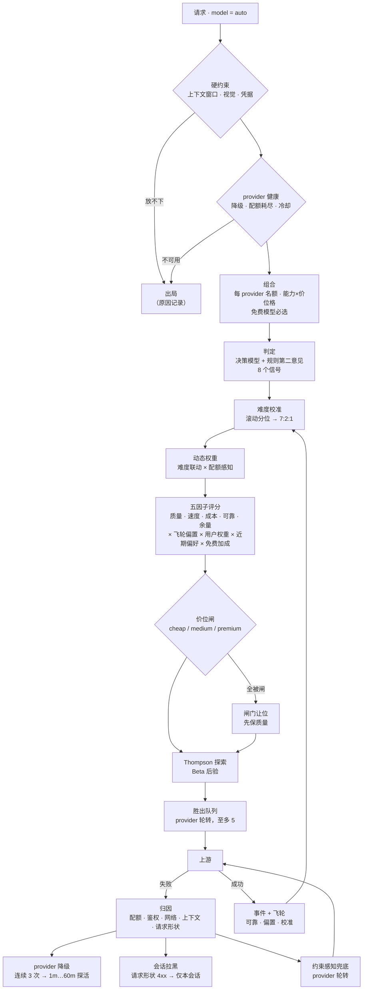

<p align="center">
  
</p>

<h1 align="center">EvolveRouter</h1>

<p align="center"><b>先想再路由，每次请求都进化。</b></p>

<p align="center">
  <a href="LICENSE"></a>
  <a href="#开发"></a>
  <a href="https://www.rust-lang.org"></a>
</p>

EvolveRouter 是给 Agent 用的**本地 LLM 路由网关**。每个请求先被判定（8 维信号）、按其方案自有货币计价、按五因子评分，再路由到最合适的模型；请求结束后结果回流，下次决策更准。交付形态是一个 Rust 二进制 + 原生 macOS 菜单栏面板 + 零构建网页面板。**你的提示词、会话与遥测不出本机。**

```
opencode · Claude Code · Codex · Pi · openclaw · hermes · dsh
                    │  model = "auto"
                    ▼
        ┌───────────────────────────┐
        │  判定 → 评分 → 路由        │   8 维信号 · 5 因子 · 方案级计价
        │  兜底 → 学习              │   质量级联 · 飞轮 · Thompson 探索
        └───────────────────────────┘
                    ▼
     zhipu · Z.ai · MiniMax · volces · opencode zen · DeepSeek · 任意 OpenAI/Anthropic API
```

<p align="center">
  
  
</p>

## 目录

- [安装](#安装) · [接入你的 Agent](#接入你的-agent)
- [请求怎么被路由](#请求怎么被路由) · [价格感知层](#价格感知层)
- [决策模型（可选）](#决策模型可选) · [请求标签](#请求标签)
- [macOS 菜单栏面板](#macos-菜单栏面板) · [网页面板](#网页面板)
- [配置](#配置) · [运维](#运维)
- [为什么不用别的 proxy](#为什么不用别的-proxy) · [内置方案](#内置方案) · [开发](#开发)

## 安装

**Homebrew（macOS 菜单栏 App + 网关）：**

```bash
brew install --cask holny/evolve/evolve-router     # 或：brew tap holny/evolve && brew install --cask evolve-router
```

cask 会安装 `EvolveRouter.app`（菜单栏面板 + 内置网关）。未公证——首次启动请右键 → 打开。

**从源码构建（只要网关，任意平台）：**

```bash
git clone https://github.com/holny/evolve-router && cd evolve-router
cargo build --release
./target/release/evo-router serve          # http://127.0.0.1:8787
```

## 接入你的 Agent

一个端点、一个模型名，你的技术栈不用改任何东西。

```jsonc
// ~/.config/opencode/opencode.jsonc
{
  "provider": {
    "evo-router": {
      "npm": "@ai-sdk/openai-compatible",
      "options": { "baseURL": "http://127.0.0.1:8787/v1" },
      "models": { "auto": { "name": "Auto (smart routing)" } }
    }
  }
}
```

OpenAI 兼容客户端：`http://127.0.0.1:8787/v1`，模型填 `auto`；Claude Code 等 Anthropic 客户端：base URL 用 `http://127.0.0.1:8787`（内置双向流式翻译）。`codex` / `pi` / `openclaw` / `hermes` / `dsh` 会自动发现——它们的 provider、key、模型都从各自配置读取，**通常无需任何配置**。

## 请求怎么被路由



| 环节 | 做什么 |
|---|---|
| **判定** | 可插拔**决策模型**读请求（领域、难度、视觉、trivial、工具密度、高风险、会话深度、体量）；内置多语言启发式判官作为独立第二意见（取严融合）。决策模型不可达时规则接管——**判定故障永不阻塞路由** |
| **难度校准** | 滚动分位把判定器的原始难度重塑到 7:2:1 目标，判定器系统性偏移也无法把路由灌满"难题" |
| **硬过滤** | 上下文窗口、视觉能力、provider 健康（降级 / 配额耗尽 / 冷却）、单模型配额、价位闸——每个出局都记录具体原因 |
| **动态权重** | 难度联动（简单 → 成本权重 ×2、质量 ×0.75；困难反之）与配额感知（[BaRP](https://arxiv.org/abs/2510.07429) Eq.1） |
| **五因子评分** | 质量 · 速度 · 成本 · 可靠 · 余量。成本是**有效成本**：官方价目、方案积分系数、缓存命中 vs 未命中（约 1/50）、峰谷时段。可靠性 = 长期 50% + 近 30 次 30% + 近 10 次 20% |
| **探索** | 每个模型 Beta 后验（判定器质量作先验均值）；Thompson 采样让样本少的自动多试、样本足的自动收敛 |
| **胜出队列** | 排序链按序尝试——失败或**质量差**（退化/空响应/工具调用损坏）升级到下一候选；链外兜底扫描覆盖未入选模型 |
| **飞轮** | 4 层反馈（传输成败、工具调用语法、会话语义回路、插件上报）经两阶段归一化，**相对跨模型中位数**学习优势 |

策略参数版本化，必须通过 `evo-router backtest`（真实生产事件回放 + PGR 裁决）才可采纳；所有学习量都有夹紧（偏置 ∈ [0.7, 1.3]，蒸馏单步 ≤ 0.15）。

### 怎么算分（公式）

`d ∈ [0,1]` 为校准后的难度（`D/3`）；`q` 质量、`s` 速度、`c` 成本、`r` 可靠、`h` 余量。

```
# 1. 质量——难度越高，对档位的要求越陡
tier = tier_for_domain(domain, tiers)          # coding / reasoning / agentic / vision
q    = 1 - d * (1 - tier ^ (1 + 2d))
q   *= 0.6 + 0.4 * max(tier, reasoning)        # 仅 high_stakes

# 2. 质量门槛——简单任务松，困难任务紧
floor(d) = 0.50 + 0.35 * d

# 3. 难度联动权重（简单→成本，困难→质量）
w_cost    = w_c * (2.0 - 1.6 * d)
w_quality = w_q * (0.75 + 0.25 * d)            # 其余不变，最后归一化
w_cost   *= 1 + 1.5 * tight                    # BaRP Eq.1，配额压力 ∈ [0,1]

# 4. 有效成本（每 1M tokens，方案币种）
in_eff = price_in_miss * (1 - hit_rate) + price_in_hit * hit_rate
cost   = (est_in / 1e6) * in_eff + (est_out / 1e6) * price_out
cost  *= peak_factor(now)                      # 例：DeepSeek 高峰 = 2x

# 5. 成本因子（越大越便宜；两把尺，绝不混用）
按量:    c = clamp(min_price / cost, 0, 1)
订阅:    c = clamp(scheme_min / quota_intensity, 0.05, 1)
成本未知: c = 0.5                               # 中性——不冒充免费

# 6. 总分
S  = w_q*q + w_s*s + w_c*c + w_r*r + w_h*h
r  = 0.5*r_long + 0.3*r_30 + 0.2*r_10          # 缺层归并
h  = (context_window - est_tokens) / context_window
S *= clamp(sqrt(user_weight * learned_bias), 0.4, 1.8)
S *= 1 + 0.05 * recency(<= 2h)                 # 缓存前缀亲和
S *= 1 + 0.10 * free                           # 免费模型，幅度有界

# 7. 组合——决定"什么能进路由"
CAP     = max(50, 8 * healthy_providers)
w_i     = 1 + quota_headroom_i + 0.1 * free_i
slots_i = clamp(round(CAP * w_i / sum(w)), 3, 0.25 * CAP)
# 免费与 pin 必选且不占名额

# 8. 健康——是"暂避"不是"判死"
provider: 连续 3 次失败 → 只进兜底，按 1m / 5m / 15m / 30m / 60m 探活
          首次成功 → 立即回到主池
model:    按失败类别冷却（配额→窗口重置，未上架→5h，瞬态→30s..10m）
session:  请求形状 4xx → 仅该 (会话, 模型)，30 分钟
```

所有学习量都被夹紧（`bias ∈ [0.7, 1.3]`、蒸馏位移 ≤ 0.15）；策略改动必须先过 `evo-router backtest`（真实事件回放）才允许采用。

### 价格感知层

| 层 | 做什么 |
|---|---|
| **模型标签**（能力 / 价位） | 按分位自动推导（两个维度各 70/20/10），分母只算**当前可用池**（冷却/配额受限/无 key 的模型动态排除）；网页可改，契约测试锁定 |
| **价位闸** | L1 只许 `cheap`、L2 放到 `medium`、L3 全开——带**倒挂例外**（更贵但有效成本 ≤ 允许池中位数的放行）与质量优先的例外放宽 |
| **比例控制器** | 观测实际选用的层级分布，把成本乘子往 7:2:1 目标纠偏 |
| **路由组合** | 可路由池是**按 provider 的组合**，不再是单一全局名单：`cap = max(50, 健康 provider × 8)`，单家 ≤25%；每家内先补齐 能力×价位 9 格，再按新发布 / 近期使用补足。免费模型必选且**不占名额**，pin 也不占。这样新模型多的 provider 吃不下全部名额，大上下文模型也不会被挤到够不着 |
| **供给感知** | 订阅配额（会过期！）优先于按量花费；可 API 查询的 provider 由 90s 看门狗刷新，其余每 5-10 分钟真实请求探测 |

## 决策模型（可选）

不配也能跑（内置规则判官功能完整）。要加就在配置文件里声明槽位——这是它**唯一**的读取来源（登录后由菜单栏 App 拉起的网关没有 shell 环境变量，只靠 env 会静默降级成规则）：

```jsonc
// ~/.evo-router/evo-router-config.jsonc
"decision": {
  "backend": "decision_model",     // decision_model = 模型 + 规则取严融合 · auto = 仅模型 · heuristic = 仅规则
  "judge_timeout_ms": 12000,       // 默认 3000；走公网中继请调大
  "slots": [
    { "kind": "jev", "api_key": "<key>" },                                    // JEV 云端（原生契约）
    { "kind": "jev",                                                           // StartLux-Decision 27B（Bamboo Relay）
      "base_url": "https://api.bamboonode.dev/v1/systemone",
      "model": "startlux-decision-27b-autothink",
      "think_mode": "never",         // 单遍作答（最快）；AutoThink 默认不确定时会先推理
      "api_key": "<bamboo-key>" },
    { "kind": "laya", "base_url": "http://127.0.0.1:8321/v1/judge" },          // 本地 sidecar（scripts/laya_server.py）
    { "kind": "openai", "base_url": "http://127.0.0.1:11434/v1",               // 任意 OpenAI 兼容端点
      "model": "<model-id>" }
  ]
}
```

- **优先级** jev > laya > openai；第一个可用槽位胜出，`protocol` / `think_mode` / `api_key_env` 均为可选。
- **硬错**（鉴权、404、无法连接）会把该槽位在进程内拉黑。**瞬态错误**（超时、5xx、解析失败）下一条请求立即重试，连续失败按指数回退（30s → 上限 10 分钟），**成功一次即清零恢复**。
- **状态如实**：`GET /api/live` 的 `decision.status` = `ok` · `degraded`（配了槽位但最近一次回退成规则，`last_fail` 给出原因如 `timeout`/`auth failed (401/403)`）· `stale`（配了未生效）· `missing`（完全没配），另有 `last_judge` / `consecutive_fails` / `retry_in_ms`。
- 改 `decision`（与 `providers`）**约 5 秒热加载**，无需重启；`POST /api/reload` 可立即触发。

## 请求标签

每条请求、每一行模型都带着**决策本身**，取值由服务端一处派生（`decision_tags.rs`），网页面板与菜单栏面板都只渲染——词表与阈值只有一份：

| 类别 | 取值 | 回答什么 |
|---|---|---|
| `difficulty` | easy / medium / hard | 网关判定的任务难度（决定质量底线与成本权重） |
| `domain` | code / math / data / agent / writing / lookup / chat | 用哪套能力档位给这道请求打分 |
| `flags` | trivial / tools / vision / stakes | 命中哪些请求特征（阈值与路由闸门同值） |
| `fit` | match / over / under | 任务难度 ↔ 所选模型能力档位是否对齐 |
| `mode` | model / model+rules / reused / rules / pinned | 谁做的判定；后三种**没有调用决策模型** |
| `capability` · `price` | basic / standard / powerful · cheap / medium / premium | 所选模型档位（Model 标签页） |

请求侧标签在请求行上，模型侧标签在 Model 列表里。占位判定一律抑制：粘性复用（`sticky`）或显式指定（`pinned`）的行只显示 `mode`，绝不显示"其实没判过"的难度。

## macOS 菜单栏面板

面板是原生 SwiftUI 应用，徽章本身就是状态灯（空闲 / 路由中 / 上次失败 / 已停止 / 启动中）。

| 区域 | 展示 |
|---|---|
| 头行 | 网关状态（`Running · 8787`）+ 版本号 · 时钟 + `judged by decision model + rules`／`judged by rules only`（**配置的**判定路径，不是最近一条请求的结果） |
| 横幅 | 异常时说明**原因**：`Decision model not configured` · `Decision model unreachable (timeout) · retrying in 26s` · `configured — applying` |
| 指标 | **今天 / 昨天**的请求数、成功率、tokens（本地日历口径，小时桶持久化） |
| Providers / Models 卡 | 最多 12 家 provider（或 50 个用过的模型），**三行**滚动行：名称 + 状态（配额条 / 余额 / `5h full` 警告，右对齐）· 数据（`tokens · hit% · t/s · TTFT`）· 标签（档位 · 模型数 · 免费 · 降级 · 去申请 key）。失败原因行内直出（`fail 25%`、`unsupported model 4m`、`no key`） |
| Recent requests | 最近几条决策 + 上述标签；标题右侧 `<N> in flight` 列出**正在生成**的请求 |
| 控制 | GitHub · Dashboard · **Stop/Start** · **Restart** · Quit · 开机自启开关 |

**重启是优雅的。** SIGINT/SIGTERM 后停止接新请求、**等在飞请求（含正在进行的 SSE 流）收尾**（上游卡死时 60s 上限兜底并记 WARN）、flush 飞轮再退出。重启不会截断正在生成的流；若有在飞请求，面板会先弹确认框。**不要对网关用 `kill -9`。**

## 网页面板

`http://127.0.0.1:8787/` —— 零构建，与面板同源同口径，视图更宽：

- **实时决策流** —— 每个请求的判定、所选模型、标签与大白话归因
- **决策解剖** —— 点任意一行：8 维判定、双判官来源、候选漏斗、评分矩阵、regret、每跳降级原因、探索门控实况
- **耗时瀑布** —— 预处理 / 决策 / TTFT / 流式，逐请求
- **Providers** —— 增删改与扫描；档位额度（5h/周/月）；Provider 实测配额一键对账；**每个 provider 的来源可追溯**（`user` / `discovered` + 来自哪个配置文件）
- **方案 / 趋势 / 飞轮** —— 逐方案用量、模型趋势、学习偏置与可靠性、校准值
- **榜单** —— LMArena 等榜单派生的能力档位叠加，附复核提醒

## 配置

唯一规范文件：**`~/.evo-router/evo-router-config.jsonc`**（JSONC：允许注释，文件自解释）；纯 JSON 变体 `evo-router-config.json`。旧名（`evo-router.toml`、`evo-router.jsonc`、`evo-router.json`、`evolve.toml`）仍可读，并在启动时**自动转换**（原文件保留为 `*.migrated`）。

| 段落 | 生效方式 |
|---|---|
| `decision`（槽位/超时/think_mode）与 `providers` | **约 5 秒热加载**；`POST /api/reload` 立即触发 |
| `server` / `policy` / `models` / `discovery` / `data` … | 需重启：面板 **Restart**，或 `launchctl kickstart -k gui/$UID/ai.evolve-router.gateway`，或 Ctrl-C 后重跑 `evo-router serve` |

`GET /api/live` 如实下发状态，不用猜：

```json
{
  "version": "0.1.9",
  "inflight": 1,
  "inflight_detail": [{ "model": "zhipuai-coding-plan/glm-5.3", "session": "…", "age_ms": 42000 }],
  "config":   { "reloaded_at_ms": 1792140000000, "restart_required": false,
                "path": "~/.evo-router/evo-router-config.jsonc", "active_slots": ["jev"] },
  "decision": { "backend": "decision_model", "status": "ok",
                "last_judge": "decision_model+rules", "last_model_used": true,
                "last_fail": null, "consecutive_fails": 0, "retry_in_ms": 0 }
}
```

### Provider 卡在管什么：档位 · 模型清单 · 配额探测 · 路由分配

Provider 不只是一条 base URL。**Providers 卡**（面板与网页一致）管四件事，卡片上直接写明：

| 职责 | 怎么做的 | 界面哪里看 |
|---|---|---|
| **方案档位** | 方案由 base URL 自动识别，你选的档位（`lite` / `pro` / `max` / `go` / `go-plus`）决定该方案的窗口额度 | 每行的档位胶囊；网页按方案可改 |
| **模型清单** | 网关拉取 provider 的 `/models`（并扫描 Agent 配置）保持目录同步——新模型入选、下架删除、协议不支持的进程内剔除 | 行上 `N models`（**端点级**，同端点两账号显示一致），完整清单在网页 |
| **配额探测** | 有官方 API / 上游响应头就用真的，没有则由网关推算；可查询的由 90s 看门狗刷新，其余每 5-10 分钟真实请求探测 | `quota obs` / `quota hdr` / `quota est` 标记 + 配额条与 `5h / monthly full` 倒计时 |
| **路由分配** | 启用且可用的 provider，其模型进入**组合**（每 provider 名额 + 能力×价位格覆盖）——受 provider 健康、价位闸、单模型配额约束；禁用/降级/冷却/配额耗尽的行会标注并不进主池（仍进兜底与探活） | 行上的 `assigned` / `disabled` / `unavailable` 徽章 |

### Provider 凭据到底从哪来

| 来源 | 内容 | 时机 |
|---|---|---|
| 各 Agent 自己的配置（`~/.config/opencode/opencode.jsonc`、`~/.codex/config.toml` …） | base_url + api_key | 每次启动读取，**从不复制**进我们的文件 |
| `~/.evo-router/state/overrides.json` | 你在面板/网页新增或编辑的 provider | 由 UI 写入，启动时重放 |
| 配置文件里的 `providers` / `models` | 显式声明——`api_key_env`（环境变量名）或**内联 `api_key`**（chmod 600） | 配置 > overrides > 自动发现 |

去重由网关内部按 `base_url + api_key` 完成（同一账号出现在两处仍是一个 provider），每行都带来源：`origin`（`user` / `discovered` / `builtin`）与 `source_path`（如 `opencode @ ~/.config/opencode/opencode.jsonc (OpenCode Go-github)`——同端点的两个账号可分辨）。

`POST /api/config/export` 把当前生效的清单（含 key 与来源）写回配置文件；之后仅凭这个文件就能复现整套配置。

### 数据目录

```
~/.evo-router/
├── evo-router-config.jsonc   配置（唯一需要手动编辑的文件）
├── events/events.jsonl       追加型决策日志（回放/统计/回测），32MB 轮转
├── state/                    快照 · 蒸馏卡 · overrides · 榜单与目录缓存
└── logs/                     gateway-child.log（菜单栏）· gateway.log（LaunchAgent）
```

旧版平铺布局与改名前的 `~/.evolve` 会在启动时自动迁移——文件只搬不删，冲突留成 `*.old-<时间戳>`。

## 运维

```bash
curl -s localhost:8787/healthz                              # ok
curl -s localhost:8787/api/live | python3 -m json.tool      # 版本 · 判定 · 槽位 · 在飞 · 是否需重启
curl -sX POST localhost:8787/api/reload                     # 立即应用 decision/providers
curl -sX POST localhost:8787/api/config/export              # 把 provider 清单落进配置文件
evo-router doctor                                           # 配置 + 目录 + 凭据体检
evo-router backtest                                         # 策略参数 A/B 回放（PGR 裁决）
evo-router service install                                  # LaunchAgent：start / stop / restart / status
```

所有响应都带 `x-ev-model`、`x-ev-reason`、`x-ev-decision-id`、`x-ev-est-tokens`、`x-ev-sticky`、`x-ev-skipped` 头；`x-ev-session` / `x-ev-policy` 可按请求指定会话与档位，`x-ev-no-cache` 绕过完成缓存。

## 为什么不用别的 proxy

| | EvolveRouter | LiteLLM / OpenRouter | RouteLLM |
|---|---|---|---|
| **路由决策** | 决策模型判定**每个请求**（8 维）+ 规则第二意见，故障开放 | 配置/前缀规则，或离线训练的路由器 | 离线训练的路由模型 |
| **自进化** | 飞轮：4 层反馈改写每模型的偏置与可靠性 | 静态权重 | 训练后静态 |
| **订阅经济** | 方案积分系数、档位额度（5h/周/月）、配额三层保护（降权 → 断粘性 → 硬滤） | 只做成本统计 | – |
| **失败处理** | key 池 → provider/端点熔断 → 胜出队列 → 链外兜底 | 重试 | – |
| **协议** | OpenAI ↔ Anthropic 双向翻译，含流式 | 偏 OpenAI | OpenAI |
| **多 Agent** | 原生识别 opencode / codex / claude-code / pi / openclaw / hermes / dsh，会话级粘性 | 通用 | 通用 |
| **部署** | 单 Rust 二进制（~7 MB），零依赖，无 Docker 无 DB | Python + DB | Python |

## 内置方案

| 方案 | 厂商 | 类型 | 计价 | 档位 | 窗口 |
|---|---|---|---|---|---|
| `zhipu-coding` | 智谱（bigmodel.cn） | Coding Plan | 积分，错峰 50% | lite / pro / max | 5h · 周 · 月 |
| `zai-devpack` | Z.ai | Coding Plan | 积分 | lite / pro / max | 5h · 周 · 月 |
| `opencode-go` | opencode zen | Go Plan | 每模型 $/1M + 单模型月上限 | go / go-plus | 月（5h = 20%） |
| `volces-coding` | 火山 | Coding Plan | AFP 积分 | lite / pro | 5h · 周 · 月 |
| `volces-agent` | 火山 | Agent Plan | AFP 积分 | — | 5h · 周 · 月 |
| `minimax-coding` | MiniMax | Coding Plan | 积分 | lite / pro / max | 5h · 周 · 月 |
| pay-as-you-go | 任意 OpenAI / Anthropic | API | 按 token 计费 | — | — |

方案由 base URL 自动识别；厂家报配额的窗口一律用**上游真值响应头**跟踪。

## 开发

```bash
cargo build --release
cargo test          # 225 个测试，在仓库根目录跑
cargo clippy        # 零警告策略
```

| Crate | 职责 |
|---|---|
| `evolve-core` | 决策引擎、评分、目录、方案注册表、配置、阈值、能力卡蒸馏 |
| `evolve-decision` | 决策模型后端（云端 / 自托管 / laya / heuristic）、槽位链、route advisor |
| `evolve-discovery` | Agent 配置扫描、远程 `/models` 拉取、models.dev 与榜单增强 |
| `evolve-memory` | 飞轮、小时桶、配额账本、健康注册表、会话存储、事件日志、策略与回测 |
| `evolve-server` | axum 网关、OpenAI/Anthropic 中继、网页面板、provider API、CLI（`evo-router`） |
| `apps/tray` | macOS 菜单栏面板（SwiftUI）+ 预览/截图工具 |

深入阅读：[架构](docs/ARCHITECTURE.md) · [决策流程](docs/DECISION-FLOW.md) · [评分因子](docs/FACTORS.md) · [macOS 快速上手](docs/QUICKSTART-macos.md) · [论文](docs/reference.md)

设计参考（批判性采纳）：两阶段奖励归一化与贝叶斯探索（[BayesianRouter][br]）、基线相对偏置更新与配额感知偏好（[BaRP][barp]）、质量触发级联（[FrugalGPT][fgpt]）、回放验证的策略变更（[MERA][mera]）、能力卡蒸馏（[FlyRoute][flyroute]）。

[br]: https://arxiv.org/abs/2510.02850
[barp]: https://arxiv.org/abs/2510.07429
[fgpt]: https://arxiv.org/abs/2305.05176
[mera]: https://arxiv.org/abs/2608.10333
[flyroute]: https://arxiv.org/abs/2605.22057

## 许可

[MIT](LICENSE)
