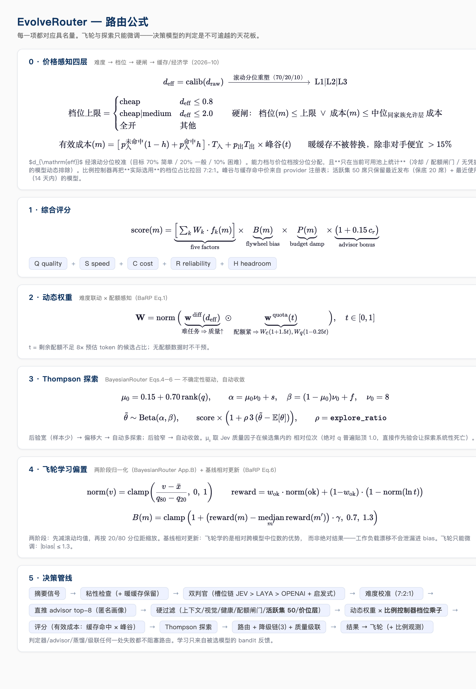
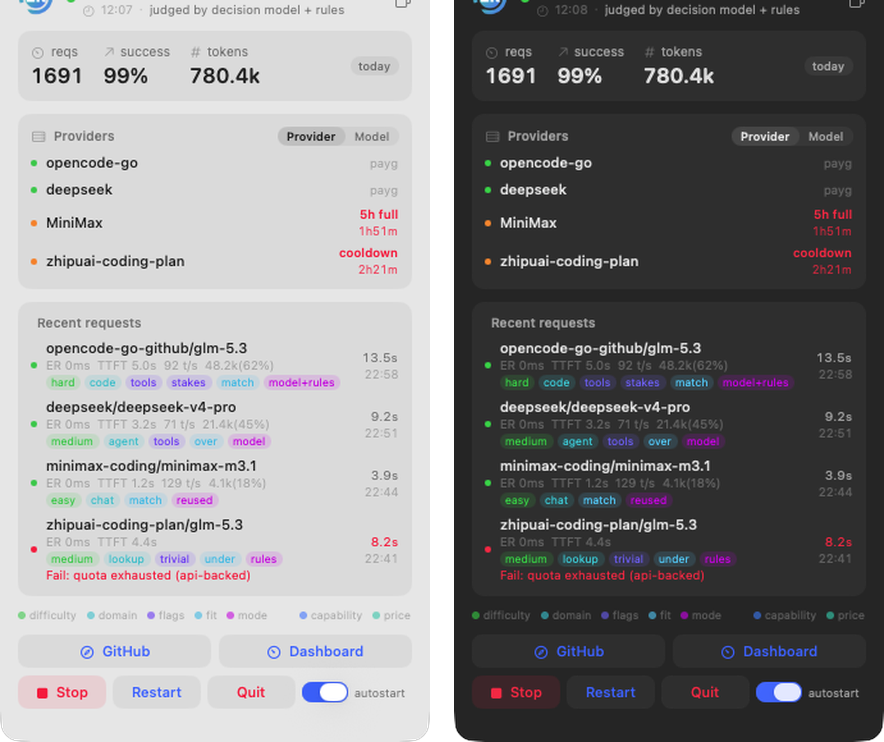
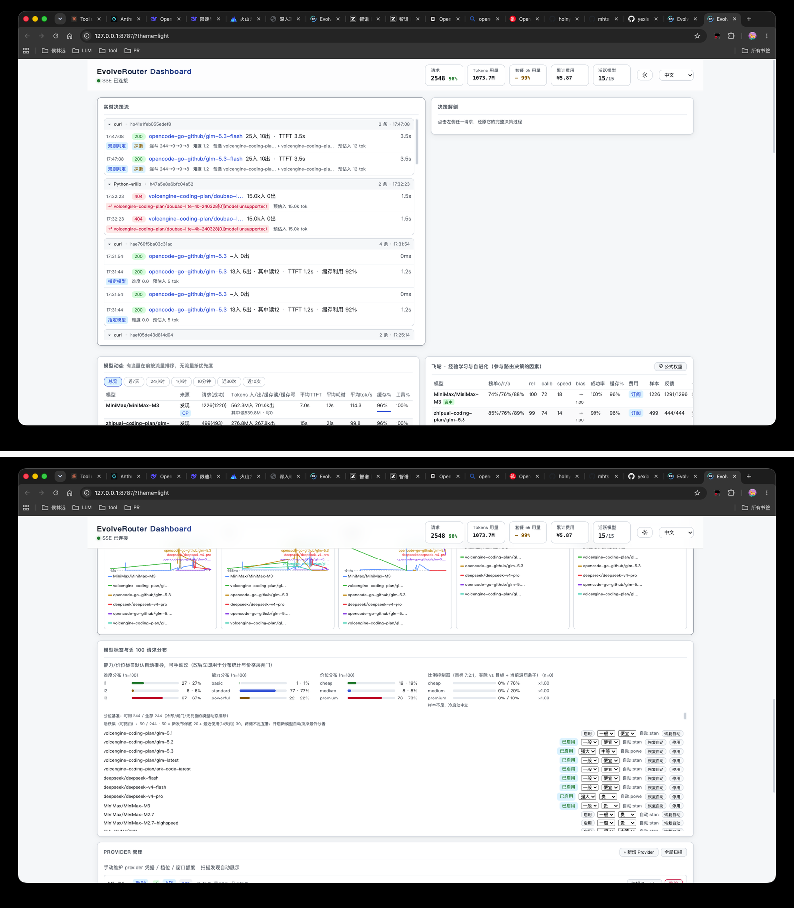

<div align="center">


# EvolveRouter：先思考，再路由。每一次请求，都让路由更聪明。

[](LICENSE)
[](https://www.rust-lang.org)
[](#开发)

[English](README.md) | [中文](README.zh-CN.md)

</div>

---

> **省下 Token，花在刀刃上。**
>
> EvolveRouter 是一个**本地优先的自进化 LLM 路由网关**，部署在你的 Agent 和所有模型之间。可插拔的**决策模型**在消耗任何 Token 之前，先对每个请求进行 **8 维度判断**——领域、难度、视觉需求、琐碎度、工具密度、风险、会话深度、尺寸。**4 层反馈飞轮**从每次结果中学习，越用越准。所有决策**本地、透明、可审计**：JSONL 事件日志、响应头 `x-ev-model / x-ev-reason / x-ev-decision-id`，以及零构建仪表盘 `127.0.0.1:8787`。**数据永不离开本机。** 一个 **6.7 MB Rust 单二进制**，零运行时依赖，无需 Docker，无需 Python，无需云端。决策模型不可用时自动降级为多语言启发式，**路由永不阻塞**。兼容 **OpenAI/Anthropic 模型**及 **opencode、Claude Code、Codex、Pi、openclaw、hermes** 等 Agent。


*各 Agent 指向单一端点 `model = "auto"`。双判官（决策模型 + 启发式）逐请求评分；飞轮把每次结果喂回排名；每个 Provider 方案按各自货币计价与预算。[编辑源文件](docs/assets/architecture.excalidraw)。*

## 价格感知路由：把钱花在该花的地方

难度先判定、再**校准到目标分布（70% 简单 / 20% 一般 / 10% 困难）**，然后映射到**能力档与价位档**——贵模型只服务困难尾巴：

| 层 | 作用 |
|---|---|
| **难度校准** | 滚动分位把判定器的原始难度重塑到 7:2:1 目标（判定器偏松也不会把路由淹没在"难任务"里） |
| **模型标签（能力/价位）** | 分位自动推导（两个维度都 70/20/10，且只在**当前可用池**上统计——冷却/配额闸门/无凭据的模型动态排除），可在面板手动修改 |
| **价位层硬闸** | L1 只用 `cheap`；L2 到 `medium`；L3 全开——带**倒挂例外**（同家族有效成本 ≤ 允许层中位则放行）与**质量优先回退**（闸门会把难任务饿死时先松闸门、再降质量门槛） |
| **有效成本** | 官方价目（套餐积分系数 / 按量 CNY·USD / 缓存命中 vs 未命中 / **峰谷时段**）——缓存命中输入价约为未命中的 1/50，暖会话永不无谓切换（**缓存经济粘性**） |
| **比例控制器** | 观测**实际选用**的档位占比，超目标就加软成本乘子，把分布拉回 7:2:1 |
| **活跃集（50）** | 只有**最近发布**（按发布日期保底 20 席）+ **最近使用**（14 天内）的模型参与路由；其余仍在面板可见、一键启用，启用会自动顶掉最低分者 |
| **供给侧** | 订阅配额（会过期！）优先于按量付费；可查配额的 provider 由 90s 看门狗刷新，不可查的每 5-10 分钟真实探测 |

`evo-router report` 回放事件日志输出端到端 KPI（难度/能力/价位分布 vs 7:2:1、简单任务用贵模型次数、缓存命中率、平均成本）。

## 决策模型槽位：JEV > LAYA > OPENAI

判官可插拔、按槽位配置（`~/.evo-router/evo-router-config.jsonc` 的 `decision.slots`，这是唯一的读取来源）；按优先级尝试，任一失败即降级启发式——**路由永不阻塞**。`/api/live` 与面板横幅会显示当前生效槽位与"未配置"提示。各 provider 的官方配额端点、价目与峰谷时段收在一张按 hostname 索引的注册表（`provider_info`）里，数据过期会提醒复核。

## 为什么不是另一个 proxy

| | EvolveRouter | LiteLLM / OpenRouter | RouteLLM |
|---|---|---|---|
| **路由决策** | 决策模型**逐请求实判**（8 维信号）+ 启发式第二意见，判败不阻塞 | 配置/前缀规则，或离线训练的模型路由 | 离线训练路由模型 |
| **自进化** | 飞轮：四层反馈（传输/工具语法/语义回路/插件）自动改写模型级学习偏置与可靠性 | 静态权重 | 训练后即静态 |
| **订阅经济学** | 方案级积分系数、档位额度（5h/周/月）、配额预算三层保护（降权→断粘性→硬过滤） | 仅成本记录 | – |
| **部署** | 单 Rust 二进制（~7MB），零依赖，无 Docker/数据库 | Python + 数据库 | Python |
| **协议** | OpenAI ↔ Anthropic 双向翻译（含流式） | OpenAI 为主 | OpenAI |
| **多 Agent** | 原生识别 opencode / codex / claude-code / pi / openclaw / hermes / dsh（会话感知粘性） | 通用 | 通用 |
| **故障处理** | 多 key 池化 → provider/端点级熔断 → 降级链 → **链外兜底扫描** | 重试 | – |

## 路由决策公式（分步推导）



上图是总览。下面按决策管线实际执行顺序，把每个公式钉在它发生的步骤上——每个量都有名字，都能在事件日志里找到。

### 第 1 步 — 硬过滤 *（无公式：二元门）*

上下文窗口不够 → 出局。任务要视觉、模型不支持 → 出局。熔断冷却中 → 出局。剩余配额不足预估 8 倍 → 出局。五因子全面被支配（Pareto）→ 出局。活下来的构成候选集。

### 第 2 步 — 动态权重 *（难度联动 × 配额感知——[BaRP](https://arxiv.org/abs/2510.07429) Eq.1）*

$$\mathbf{W} = \text{norm}\big(\mathbf{w}^{\mathrm{diff}}(d_{\mathrm{eff}}) \odot \mathbf{w}^{\mathrm{quota}}(t)\big), \quad t = \frac{\text{配额不足 8×预估 token 的候选数}}{\text{有配额数据的候选数}}$$

*发生了什么*：难任务（d_eff 高）权重倒向质量；简单任务倒向成本。独立地，当候选中配额紧张的比例升高（t → 1）时，成本权重 ×(1+1.5t)、质量让位 ×(1−0.25t)。无配额数据 → 不干预。

### 第 3 步 — 五因子评分 + advisor 加分

$$\mathrm{base}(m) = \sum_k W_k \cdot f_k(m), \qquad f_k \in \{\text{质量, 速度, 成本, 可靠, 余量}\}$$
$$\mathrm{base}(m) \times = 1 + 0.15 \cdot c_r \quad \text{（advisor 以置信度 } c_r > 0.3 \text{ 举荐该模型时）}$$

*发生了什么*：每个候选先**按其方案自己的货币计价**（积分 / 美元 / AFP）再进入成本评分。advisor（决策模型，看 top-8 匿名画像）可直接为它的举荐加最多 +15%。

### 第 4 步 — Thompson 探索 *（不确定性驱动——[BayesianRouter](https://arxiv.org/abs/2510.02850) Eqs.4–6，跨域借鉴）*

$$\mu_0 = 0.15 + 0.70\,\mathrm{rank}(q_m), \quad \alpha = \mu_0 \nu_0 + s, \quad \beta = (1-\mu_0)\nu_0 + f, \quad \nu_0 = 8$$
$$\tilde{\theta} \sim \mathrm{Beta}(\alpha, \beta), \qquad \mathrm{final}(m) = \mathrm{base}(m) \times \big(1 + 3\rho(\tilde{\theta} - \mathbb{E}[\theta])\big)$$

*发生了什么*：s/f 是该模型近窗成败计数。观测少的模型后验宽 → 采样偏移大 → 被多试；观测足的模型后验窄 → 偏移消失 → 不再白给机会。ρ = `explore_ratio`（默认 0.1，典型扰动 ±3%）。先验均值 μ₀ 取决策模型质量因子的候选集**相对位次**——绝对 q 值普遍贴顶 1.0，饱和的先验会让探索静默死亡（实测教训）。

### 第 5 步 — 飞轮偏置 *（两阶段归一化 + 基线相对更新）*

$$\text{norm}(v) = \text{clamp}\!\left(\frac{v - \bar{x}}{q_{80} - q_{20}},\ 0,\ 1\right), \qquad \mathrm{reward} = w_{\mathrm{ok}} \cdot \text{norm}(\mathrm{ok}) + (1{-}w_{\mathrm{ok}})\big(1 - \text{norm}(\ln \mathrm{ms})\big)$$
$$B(m) = \text{clamp}\big(1 + (\mathrm{reward}_m - \text{median}_{m'}\mathrm{reward}_{m'}) \cdot \gamma,\ 0.7,\ 1.3\big)$$

*发生了什么*：每个模型近 30 条结果（成功 + 延迟，ln 压缩）归一成 [0,1] 的 reward——先对自己的滚动均值中心化，再按自己的 20/80 分位距缩放（这让 200ms 的模型和 20s 的模型可比）。bias 学的是**相对跨模型中位数的优势**，不是绝对结果——整个工作负载变难时所有 reward 同降、中位数跟着动、bias 纹丝不动。最终分数乘以 B(m)。飞轮只能微调：|B| ≤ 1.3，决策模型的判定是天花板。

### 第 6 步 — 路由之后

质量级联：**成功但**退化 / 空响应 / 工具调用损坏的响应被丢弃，试链下一候选——链首门控最严，越往后越宽；链耗尽仍返回降质响应而非报错。逻辑相同的重复请求命中本地完成缓存。每个事件记录 `regret = 最优可得分 − 实选分`，路由质量可度量；任何策略参数变更必须先过 `evo-router backtest`（生产事件回放，按性能差距恢复率 PGR 裁决）才可上线。

## 三大支柱

1. **智能决策，而非前缀规则。** 每个请求都由可插拔决策模型（云端或自托管开源后端，同协议）——判定 8 维信号（领域、难度、视觉、trivial、工具密度、高风险、会话深度、体量）。内置多语言启发式判官作为独立第二意见（取严融合，补决策模型的中文短板）；决策模型不可达时启发式接管，**路由永不阻塞**。 重新判定只在**工具循环**内被跳过（本轮是同一轮工具调用的延续），且要求上轮判定仍是低难度、量级不失控、工具集未变、服务健康——用户**新发一条消息**一定触发完整重判。可选 `laya` 后端插入同一接口。
2. **资金感知路由。** 每个候选先用其方案自己的货币计价——积分（智谱 / Z.ai / MiniMax）、美元（opencode zen Go）、AFP（火山）——再进入评分。配额预算三层保护：额度消耗 **>60%** 降权、**>85%** 断开会话粘性、**>95%** 直接出局——把余量留给真正需要的任务。
3. **大模型方案，一个面板管控。** 厂商订阅方案是一等公民：档位、额度、积分系数、每模型美元限额全部内置；面板按窗口展示 Provider 实测配额，一键对账。


## 内置方案

| 方案 | 厂商 | 类型 | 计价模型 | 档位 | 窗口 |
|---|---|---|---|---|---|
| `zhipu-coding` | 智谱 (bigmodel.cn) | Coding Plan | 积分，闲时 5 折 | lite / pro / max | 5h · 周 · 月 |
| `zai-devpack` | Z.ai | Coding Plan | 积分 | lite / pro / max | 5h · 周 · 月 |
| `opencode-go` | opencode zen | Go Plan | 每模型 $/1M + 每模型月度美元限额 | go / go-plus | 月（5h = 20%） |
| `volces-coding` | 火山方舟 | Coding Plan | AFP 积分 | lite / pro | 5h · 周 · 月 |
| `volces-agent` | 火山方舟 | Agent Plan | AFP 积分 | — | 5h · 周 · 月 |
| `minimax-coding` | MiniMax | Coding Plan | 积分 | lite / pro / max | 5h · 周 · 月 |
| 按量计费 | 任意 OpenAI / Anthropic | API | $ / token | — | — |

方案按 base URL 自动识别；每个窗口（5h / 周 / 月）均有跟踪，厂商下发配额头时以 Provider 实测为准。


## 功能

- **本地部署，数据安全** — 单 Rust 二进制（~7 MB），零运行时依赖，无 Docker、无 Python、无云。整条路由链全在主机内：用户数据、会话内容、遥测信号**不出网**。每一次决策落入本地 JSONL 事件日志——审计、迁移、删除全部可控。
- **决策模型智能判断，懂经济账** — 决策模型（可插拔后端 + 多语言启发式第二意见，取严融合）按 8 维信号（领域、难度、视觉、工具密度、高风险…）判定任务画像；每个候选评分前先按**其方案自有货币**计价（智谱 / Z.ai / MiniMax 积分、opencode Go 美元、volces AFP），再复合质量/速度/成本/可靠/余量五因子。三层预算保护：>60% 降权、>85% 断粘性、>95% 出局。
- **科学公式归因** — 5 因子（质量·速度·成本·可靠·余量）+ 难度联动权重 + 飞轮偏置——完整推导见下方「[路由决策公式](#路由决策公式分步推导)」。每项都能逐行追溯，不是黑盒。
- **自进化飞轮** — 每次请求喂入飞轮，4 层反馈（传输成败 / 工具调用语法 / 会话语义回路 / 插件显式上报）先经**两阶段归一化**（减滚动均值 + 20/80 分位距钳制），再**相对跨模型中位数**学习优势——工作负载漂移不会泄漏进学习结果。长记忆 + 短期 + 即时三层融合（50% / 30% / 20%）。**用量越大、路由越准**。
- **不确定性驱动探索** — 无固定 ε-greedy。每个候选维护 Beta(α, β) 后验（成败计数 + 决策模型评分作先验均值），Thompson 采样让样本少的模型自动多探索、样本足的自动收敛。策略参数版本化，必须通过 `evo-router backtest` 生产事件回放（PGR 裁决）才可采纳。
- **质量级联与完成缓存** — 降级链不只由错误触发：退化输出 / 空响应 / 工具调用损坏也会升级到链下一候选，且链首门控最严、逐级放宽；链耗尽仍返回降质响应而非报错。逻辑内容相同的重复请求命中本地完成缓存（TTL 受限、`x-ev-no-cache` 绕过）——零成本零延迟。
- **能力卡自蒸馏** — 每模型每积累 50 个成功，决策模型基于观测统计重估其能力 tiers（保守收缩，单步偏移 ≤ 0.15）——Provider 静默换模型不再导致目录过期。用户显式声明永不覆盖；删除 `distilled.json` 即回滚。
- **多 Agent + 多 Provider 适配** — opencode / Claude Code / Codex / Pi（编码 Agent），openclaw / hermes / dsh（本地 Harness），任何 OpenAI / Anthropic 兼容客户端都**无需改代码**接入。路由到任何 OpenAI 兼容**或** Anthropic 上游；Switchyard 双向流式翻译（含事件映射与确定性 ID），Claude Code 开箱即用。订阅方案（zhipu coding / Z.ai / opencode zen / volces / MiniMax）与按量 API 共用同一端点。
- **极速决策，零依赖部署** — 单 Rust 二进制 6.7 MB；冷启动 <30 ms；单请求仅多 <300 ms（一次决策模型评分 + 启发式兜底）。多 key 池化轮换、provider / 端点双层熔断、链外兜底扫描——单家 Provider 全挂也不会整体哑掉。
- **每条请求都带着自己的决策标签** — 难度、任务域、命中特征（trivial / tools / vision / stakes）、难度↔能力匹配、判定来源（`model` / `model+rules` / `reused` / `rules` / `pinned`）由**服务端一次算好**写进事件，网页与 macOS 面板渲染完全一致；词表与阈值只有一份（`decision_tags.rs` + `thresholds.rs`），两端不可能漂移。
- **本地面板管控，全程决策可见** — 零构建面板 `http://127.0.0.1:8787` 暴露：实时决策流（每行附大白话归因）、评分矩阵、降级链与每跳剔除原因、耗时瀑布、模型趋势、Provider 与配额管理、飞轮学习状态。所有响应携带 `x-ev-model / x-ev-reason / x-ev-decision-id` 头；`/api/events` 暴露 JSONL 决策日志可查询可回放。

## 快速开始

**要求：** Rust stable（2024 edition），任意 OpenAI 兼容或 Anthropic Provider 凭据。

```bash
git clone https://github.com/holny/evolve-router.git
cd evolve-router
cargo build --release

# 二进制在 target/release/evo-router
./target/release/evo-router serve
# 网关监听 http://127.0.0.1:8787
```

配置位于 `~/.evo-router/evo-router-config.jsonc`；文件不存在时直接用内置默认（写盘只发生在旧安装的一次性迁移里）。填入 Provider 的 base URL 与 API key：

```jsonc
// ~/.evo-router/evo-router-config.jsonc（JSONC：允许注释）
{
  "server": { "host": "127.0.0.1", "port": 8787 },
  "models": [
    {
      "id": "zhipuai-coding-plan/glm-5.3",
      "provider": "zhipuai-coding-plan",
      "base_url": "https://open.bigmodel.cn/api/coding/paas/v4",
      "api_key_env": "ZHIPU_API_KEY",       // 或内联 "api_key": "..."（文件 chmod 600）
      "upstream_model": "glm-5.3",
      "context_window": 1024000,
      "cost": { "input": 0.0, "output": 0.0 }   // plan 模型边际成本 ≈ 0
    }
  ]
}
```

决策模型写在同一份文件的 `decision.slots` 里——这是它唯一的读取来源（登录后由菜单栏 app 拉起的网关没有 shell 环境变量）：

```jsonc
{
  "decision": {
    "backend": "decision_model",     // decision_model = 模型 + 规则取严融合；auto = 仅模型；heuristic = 仅规则
    "judge_timeout_ms": 12000,       // 默认 3000；走公网中继请调大
    "slots": [
      { "kind": "jev", "api_key": "<key>" },                                   // JEV 云端（原生契约）
      { "kind": "jev",                                                          // StartLux-Decision 27B（经 Bamboo Relay）
        "base_url": "https://api.bamboonode.dev/v1/systemone",
        "model": "startlux-decision-27b-autothink",
        "think_mode": "never",        // 单遍作答（最快）；AutoThink 默认不确定时会先推理
        "api_key": "<bamboo-key>" },
      { "kind": "laya", "base_url": "http://127.0.0.1:8321/v1/judge" },        // 本地 sidecar，免 key
      { "kind": "openai", "base_url": "http://127.0.0.1:11434/v1",             // 任意 OpenAI 兼容端点
        "model": "<model-id>" }
    ]
  }
}
```

配任一槽位即启用；全都不配则退回内置多语言启发式判官（功能完整）。槽位按 **jev > laya > openai** 顺序尝试，硬错（鉴权/404/无法连接）在进程内拉黑该槽位，全链失败由启发式兜底——决策模型故障永不阻塞路由。用远程判定端点时 `judge_timeout_ms` 很关键（27B 判定经中继约 2.5s，默认 3s 会在响应到达前超时）。

### 配置格式与凭据存放位置

配置是**同一套 serde 结构**。规范文件是 **`~/.evo-router/evo-router-config.jsonc`**（JSONC：带注释的 JSON，文件自解释），纯 JSON 变体为 `evo-router-config.json`。旧名（`evo-router.toml`、`evo-router.jsonc`、`evo-router.json`、`evolve.toml`）仍可读，并会在启动时**自动转换**（原文件保留为 `*.migrated`）。

Provider 凭据到底从哪来：

| 来源 | 内容 | 时机 |
|---|---|---|
| 各 Agent 配置（`~/.config/opencode/opencode.jsonc`、`~/.codex/config.toml` …） | base_url + api_key，由发现器读取 | 每次启动读取，**从不复制**进我们的文件 |
| `~/.evo-router/state/overrides.json` | 你在面板/网页新增或编辑的 provider（base_url、api_key、档位、协议…） | 由 UI 写入，启动时重放 |
| `evo-router-config.jsonc` 的 `providers` | 显式 provider 清单，每条带 `origin`（`user` / `discovered` / `builtin`），发现来的还带 `source_path`（从哪个 Agent 配置读的，如 `opencode @ ~/.config/opencode/opencode.jsonc`） | 配置 > overrides.json > 自动发现 |
| `evo-router-config.jsonc` 的 `models` | 逐模型声明——`base_url`、`api_key_env`（环境变量名）或**内联 `api_key`**（chmod 600） | 静态生效，同 id 优先于发现结果 |

用 **`POST /api/config/export`** 把当前生效的 provider 清单（含 key）落进配置文件——之后仅凭这个文件就能复现整套配置，不再依赖 Agent 配置。去重由网关内部按 `base_url + api_key` 完成，同一账号出现在两处也仍是一个 provider。

结论：**配置文件里可以什么都不写**（发现器会接手你已有的 Agent 凭据）；也**可以全都写进去**，做成显式的单文件配置。

### 配置生效方式

| 段落 | 生效方式 |
|---|---|
| `decision`（含 `decision.slots`） | **约 5 秒内热加载**——判定槽位链与其 route advisor 原地替换，**无需重启**；想立刻生效：`curl -X POST http://127.0.0.1:8787/api/reload` |
| 其余段落（`[server]` / `[policy]` / `[[models]]` / `[discovery]` …） | 需重启——菜单栏面板 **Stop → Start**，或 LaunchAgent 模式 `launchctl kickstart -k gui/$UID/ai.evolve-router.gateway`，或前台进程 Ctrl-C 后重新 `evo-router serve` |

`/api/live` 会如实下发状态，不用猜：

```json
{
  "config":   { "reloaded_at_ms": 1792116723449, "restart_required": false, "restart_reason": null,
                "path": "~/.evo-router/evo-router-config.jsonc", "active_slots": ["jev"] },
  "decision": { "backend": "decision_model", "status": "ok",
                "last_judge": "decision_model+rules", "last_model_used": true,
                "last_fail": null }
}
```

`decision.status` 取值为 `ok`（按配置判定）/ `degraded`（配了槽位但最近一次回退成规则，`last_fail` 带原因如 `timeout`、`auth failed (401/403)`）/ `stale`（配了但尚未生效）/ `missing`（什么都没配）。macOS 面板与网页渲染同一份数据，非 `ok` 状态会显示黄字横幅说明原因。

非 `[decision]` 段落改动时 `restart_required` 置位；把文件改回原样它会自动清除（不留假提醒）。

### 数据目录

网关写的一切都在 `~/.evo-router/`（可用 `[data] dir` 改）：

```
~/.evo-router/
├── evo-router-config.jsonc  # 配置（唯一需要手动编辑的文件）
├── events/               # 追加型决策日志（回放/统计/回测的数据底座）
│   ├── events.jsonl
│   └── events.jsonl.1     # 32MB 轮转
├── state/                # 机器写的状态与缓存
│   ├── snapshot.json       # 飞轮快照（含小时桶）
│   ├── distilled.json      # 能力卡蒸馏
│   ├── overrides.json      # 面板/网页调控覆盖
│   ├── benchmarks.json     # 榜单缓存
│   ├── modelsdev.json      # models.dev 参考缓存
│   └── remote-models.json  # /v1/models 扫描缓存
└── logs/
    ├── gateway.log         # LaunchAgent 模式
    └── gateway-child.log   # 菜单栏 app 子进程
```

旧版平铺布局（以及改名前的 `~/.evolve`）会在启动时自动归类迁移——文件只搬不删；同名冲突的那份留成 `.old-<时间戳>`。

### 接入你的 Agent

**opencode**（`~/.config/opencode/opencode.jsonc`）：

```jsonc
{
  "provider": {
    "evo-router": {
      "npm": "@ai-sdk/openai-compatible",
      "options": { "baseURL": "http://127.0.0.1:8787/v1" },
      "models": {
        "auto": {
          "name": "Auto (smart routing)",
          "attachment": true,
          "reasoning": true,
          "tool_call": true
        }
      }
    }
  }
}
```

**Claude Code：**

```bash
export ANTHROPIC_BASE_URL=http://127.0.0.1:8787
export ANTHROPIC_MODEL=auto
claude
```

**任意 OpenAI 兼容客户端：** base URL `http://127.0.0.1:8787/v1`，model `auto`。

### 以服务方式运行（macOS LaunchAgent）

```bash
evo-router service install   # 另有：start / stop / restart / status
```


### macOS 菜单栏 —— 状态一目了然

在 macOS 上，EvolveRouter 以原生 SwiftUI 面板常驻**菜单栏**。品牌徽章本身就是实时状态指示器，共五种状态：

| 状态 | 含义 |
|---|---|
| 彩盘白 ER | 运行中，空闲 |
| **浅绿 ER + 呼吸** | 正在路由 |
| **浅黄 ER** | 上一次请求失败（持续到下次请求开始） |
| 白盘镂空 ER | 网关已停止 |
| 灰色 + 呼吸 | 网关启动中 |

面板实时推送最近决策、每家 Provider 的 5 小时配额、缓存命中率、吐字速率、TTFT、冷却倒计时与原因，接入配置一键复制——无需打开完整面板。

头行回答"现在是谁在判定、是否正常"：第一行是网关状态（`Running · 8787`）与版本号，第二行是同步时间 + **`judged by decision model + rules`**／**`judged by rules only`**——显示的是**配置的判定路径**，不是最近一条请求的结果。配了决策模型但当前不可用时，橙色横幅会写明原因（`Decision model unreachable (timeout)`／`(auth failed 401/403)`／`not configured`／`applying`）。控制行有 **Stop/Start**、带文字的 **Restart**（让 `[server]` / `[policy]` / `models` 改动生效）与 Quit；Providers 卡是所选窗口的**用量 top 6** 快照（网页面板才是全量管理列表）。

每条请求、每行模型都**带着这次决策本身的标签**，取值与网页面板同源（服务端一次算好）：

| 类别 | 取值 | 回答什么 |
|---|---|---|
| `difficulty` | easy / medium / hard | 网关判定的任务难度（决定质量底线与成本权重） |
| `domain` | code / math / data / agent / writing / lookup / chat | 用哪套能力档位给这道请求打分 |
| `flags` | trivial / tools / vision / stakes | 命中哪些请求特征（阈值与路由闸门同值） |
| `fit` | match / over / under | 任务难度 ↔ 所选模型能力档位是否对齐 |
| `mode` | model / model+rules / reused / rules / pinned | 谁做的判定；后三种**没有调用决策模型** |
| `capability` · `price` | basic / standard / powerful · cheap / medium / premium | 所选模型的档位（Model 标签页） |

顶部指标可在**今天 / 昨天**之间切换（本地日历窗口，小时桶持久化），Providers 卡可在 Provider / 逐模型两个维度间切换。




## 面板

打开 `http://127.0.0.1:8787/`：



- **实时决策流**——每个请求的 8 维判定、所选模型、大白话归因
- **评分矩阵**——头部候选的分因子得分（质量/速度/成本/可靠/余量）
- **降级链**——试了哪些模型、挂在哪、为什么
- **耗时瀑布**——预处理/决策/TTFT/流式，逐请求
- **Provider 管理**——增删/扫描 Provider、档位额度（5h/周/月）、Provider 实测配额、一键对账
- **飞轮卡**——各模型的学习偏置、实测可靠性、校准值、语义确认数


## 路由决策原理

```
请求 → 信号提取 → 会话粘性检查（+ 暖缓存保留）
    → 判官槽位链（JEV > LAYA > OPENAI + 多语言启发式）
    → 难度校准（滚动分位 → 目标 70/20/10）
    → 路由 advisor（top-8 候选匿名化，决策模型直接举荐）
    → 硬过滤（窗口/视觉/熔断/配额闸门/活跃集 50/价位层硬闸）
    → 动态权重（难度联动 × 配额感知）× 比例控制器档位乘子
    → 五因子评分（成本 = 官方价目有效成本 × 缓存命中 × 峰谷）× 飞轮偏置
    → Thompson 探索（Beta 后验采样——不确定性驱动）
    → 路由 → 降级链(3) → 质量级联
    → 结果观测 → 喂给飞轮（+ 比例控制器观测）
```

自进化机制批判性地借鉴近期路由研究：两阶段奖励归一化与贝叶斯探索
（[BayesianRouter][br]，跨域）、基线相对偏置更新与配额感知偏好
（[BaRP][barp]）、质量触发级联（[FrugalGPT][fgpt]——本领域背书最强的
工作，1300+ 引用）、策略回放验证（[MERA][mera]）、能力卡蒸馏
（[FlyRoute][flyroute]）。飞轮只能微调——每个学习量都有钳制
（bias ∈ [0.7, 1.3]、级联阈值按链位分级、蒸馏单步偏移 ≤ 0.15），
任何策略变更必须先通过 `evo-router backtest` 在生产事件回放上
以 PGR（性能差距恢复率）裁决后才可采纳。

```bash
evo-router backtest              # 在 events.jsonl 上 A/B 回放两套策略参数（PGR 裁决）
```

[br]: https://arxiv.org/abs/2510.02850
[barp]: https://arxiv.org/abs/2510.07429
[fgpt]: https://arxiv.org/abs/2305.05176
[mera]: https://arxiv.org/abs/2608.10333
[flyroute]: https://arxiv.org/abs/2605.22057

深入阅读：[架构](docs/ARCHITECTURE.md) · [决策流](docs/DECISION-FLOW.md) · [评分因子](docs/FACTORS.md) · [论文综合](docs/reference.md)


## 开发

```bash
cargo build --release
cargo test          # 220 个测试
cargo clippy        # 零警告策略
```

Workspace 结构：

| Crate | 职责 |
|---|---|
| `evolve-core` | 决策引擎、评分、目录、方案注册表、配置、蒸馏 |
| `evolve-decision` | 决策模型后端（云端或自托管、laya、启发式）+ 路由 advisor |
| `evolve-discovery` | Agent 配置扫描、远程 /models 拉取、models.dev 补全 |
| `evolve-memory` | 飞轮、配额账本、健康注册表、会话存储、事件日志、策略与回放 |
| `evolve-server` | Axum 网关、relay、面板、Provider API、CLI（二进制：`evo-router`） |

贡献指南见 [CONTRIBUTING.md](CONTRIBUTING.md) / [CONTRIBUTING.zh-CN.md](CONTRIBUTING.zh-CN.md)。


## 许可证

[MIT](LICENSE)
